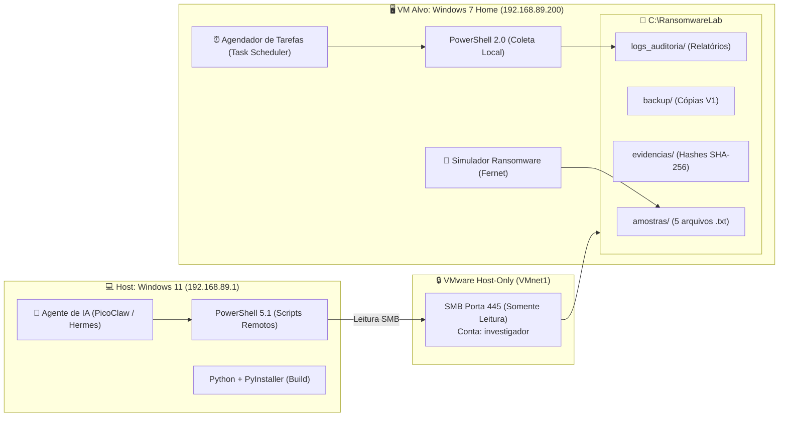
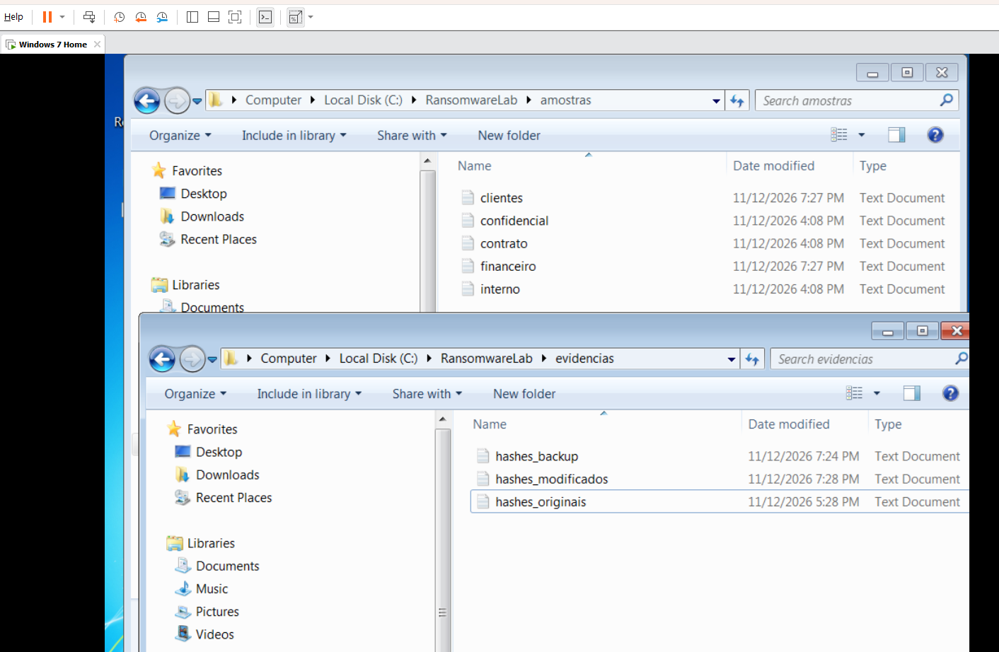

# 🛡️ DIO — Ransomware Lab & AI Defense

Repositório desenvolvido para o desafio prático de Cibersegurança da **Digital Innovation One (DIO)** — *Simulando o Comportamento de Malwares em Python e Estratégias de Defesa*.

Este projeto vai além da implementação básica de criptografia/descriptografia em Python: foi construído um **laboratório completo de simulação e resposta a incidentes**, integrando uma máquina virtual **Windows 7 Home** isolada (ambiente vítima), scripts de criptografia reversível com `Fernet` (`cryptography`), rotinas de auditoria local/remota em **PowerShell**, validação matemática de integridade por **SHA-256** e investigação forense assistida por **Agente de Inteligência Artificial (Hermes / PicoClaw)** a partir do host **Windows 11**.

> ⚠️ **Aviso de Finalidade Educacional:** Todo o código e os procedimentos documentados neste repositório foram desenvolvidos exclusivamente para fins didáticos e executados em ambiente virtual isolado (*Host-Only*), operando apenas sobre uma lista fechada de 5 arquivos de texto fictícios.

---

## 🎯 Objetivos do Projeto

1. **Simular o comportamento de um Ransomware em Python:**
   - Criar arquivos de teste fictícios e registrar suas impressões digitais (hashes SHA-256).
   - Implementar scripts em Python utilizando **Fernet (AES-128-CBC + HMAC-SHA256)** para criptografar e descriptografar os arquivos do laboratório.
   - Exibir avisos educativos de simulação e preservar chaves de recuperação para reversão controlada.
2. **Validar Estratégias de Recuperação (Descriptografia vs. Backup):**
   - Demonstrar a diferença prática entre recuperar arquivos pela chave criptográfica e restaurá-los a partir de backups íntegros, validando cada etapa via SHA-256.
3. **Investigar e Responder ao Incidente com Inteligência Artificial:**
   - Utilizar o agente **PicoClaw / Hermes** no Windows 11 para auditar remotamente (em modo *somente leitura* via SMB) os logs gerados na VM Windows 7, identificando arquivos alterados, processos, eventos de segurança e serviços suspeitos.
4. **Documentar Medidas de Prevenção e Defesa em Profundidade:**
   - Refletir sobre controles preventivos, detectivos e corretivos contra ransomware no mundo real.

---

## 🏗️ Arquitetura do Laboratório



| Ambiente / Recurso | Especificação | Função no Laboratório |
|---|---|---|
| **Máquina Hospedeira** | Windows 11 (`192.168.89.1`) | Desenvolvimento Python, compilação e execução do agente de IA (PicoClaw/Hermes) |
| **Máquina Virtual Alvo** | Windows 7 Home Basic (`192.168.89.200`) | Sistema isolado onde residem `C:\RansomwareLab` e as amostras fictícias |
| **Rede Virtual** | VMware `VMnet1` (*Host-Only*) | Comunicação restrita entre Host e VM, sem acesso externo/internet |
| **Acesso de Auditoria** | `\\192.168.89.200\RansomwareLab` | Compartilhamento SMB com permissão `READ` para o usuário `investigador` |


---

## 📂 Estrutura do Repositório

```text
dio-ransomware-lab-ai-defense/
├── README.md                                     # Documentação principal do projeto
├── requirements.txt                              # Dependências Python (cryptography)
├── .gitignore                                    # Proteção contra envio de binários, chaves e ambientes virtuais
│
├── simulador/                                    # Scripts Python de Simulação e Recuperação
│   ├── simulador.py                              # Verificação do laboratório, cálculo SHA-256 e criação/validação de backup
│   ├── criptografar.py                           # Criptografa as 5 amostras (.txt -> .encrypted) com confirmação
│   ├── descriptografar.py                        # Recupera os arquivos .encrypted utilizando a chave Fernet
│   ├── criptografar_beta.py                      # Versão didática: gera cópias .encrypted preservando os originais
│   ├── descriptografar_beta.py                   # Versão didática: valida e restaura cópias criptografadas
│   └── simulador_etapas.py                       # CLI integrada (verificar, simular, recuperar, validar) + log JSONL
│
├── scripts_auditoria/                            # Scripts PowerShell de Coleta Forense e Validação
│   ├── 01_analise_arquivos_local.ps1             # Inventário local e cálculo SHA-256 (.NET) para Win7 PowerShell 2.0
│   ├── 02_analise_eventos_processos_local.ps1    # Coleta local de SO, Processos, Serviços (WMI) e Event Logs (48h)
│   ├── 01_analise_arquivos_remoto.ps1            # Auditoria remota de arquivos e hashes via SMB a partir do Win11
│   ├── 02_analise_eventos_processos_remoto.ps1   # Inventário remoto via SMB + WMI a partir do Win11
│   └── comparar_hashes.ps1                       # Script rápido para comparação de integridade SHA-256 (amostras vs backup)
│
├── testes/                                       # Ambiente de testes reproduzível localmente
│   └── RansomwareLab/
│       ├── amostras/                             # 5 arquivos fictícios (clientes, confidencial, contrato, financeiro, interno)
│       ├── backup/                               # Cópias íntegras de segurança
│       └── evidencias/
│           └── hashes_originais.txt              # Linha de base SHA-256 dos arquivos de teste
│
├── docs/                                         # Documentação Técnica Aprofundada e Relatórios
│   ├── 01_cronologia_e_rede_lab.md               # Configuração de rede Host-Only, Firewall, SMB, WMI e Hashes V1/V2
│   ├── 02_configuracao_task_win7.md              # Tutorial de automação de auditoria no Task Scheduler do Windows 7
│   ├── 03_relatorio_forense_ia.md                # Prompts e Relatório Forense completo gerado pelo agente PicoClaw
│   ├── 04_guia_codigo_criptografia.md            # Apostila explicando linha a linha o código de criptografia Python
│   └── 05_guia_codigo_descriptografia.md         # Apostila explicando linha a linha o código de descriptografia Python
│
└── imgs/                                         # Capturas de tela documentando todas as etapas práticas
```

---

## 🔬 Passo a Passo do Experimento Realizado

### Etapa 1 — Criação das Amostras, Backup e Linha de Base SHA-256

No diretório `C:\RansomwareLab\amostras` da VM Windows 7 (e replicado em [`testes/RansomwareLab/amostras`](testes/RansomwareLab/amostras)), foram criados cinco documentos fictícios:
- `clientes.txt`
- `confidencial.txt`
- `contrato.txt`
- `financeiro.txt`
- `interno.txt`

Antes de qualquer alteração ou simulação, foram geradas cópias na pasta `backup/` e calculados os hashes SHA-256 originais (`hashes_originais.txt`), estabelecendo uma prova matemática de integridade.




---

### Etapa 2 — Desenvolvimento do Simulador de Ransomware em Python

Foram desenvolvidas três abordagens complementares na pasta [`simulador/`](simulador/) utilizando a biblioteca `cryptography.fernet`:

1. **Preparação e Verificação ([`simulador.py`](simulador/simulador.py)):** Valida a estrutura do laboratório, calcula os hashes SHA-256 em modo exclusivo (`'x'`, sem sobrescrever evidências anteriores) e verifica a integridade do backup.
2. **Simulação Direta e Reversão ([`criptografar.py`](simulador/criptografar.py) & [`descriptografar.py`](simulador/descriptografar.py)):**
   - Opera sobre uma **lista estrita (`NOMES`)** dos 5 arquivos fictícios e valida que o script está dentro de `RansomwareLab`, rejeitando links simbólicos (`is_symlink()`).
   - Solicita confirmação explícita no console (`Digite SIMULAR para confirmar:` / `Digite RECUPERAR para confirmar:`).
   - Gera a chave simétrica (`Fernet.generate_key()`), salva em `chave_recuperacao.key`, valida a descriptografia em memória antes de substituir cada `.txt` por `.encrypted` e restaura integralmente os originais na recuperação.
3. **Simulação em Cópias e CLI Auditável ([`criptografar_beta.py`](simulador/criptografar_beta.py), [`descriptografar_beta.py`](simulador/descriptografar_beta.py) e [`simulador_etapas.py`](simulador/simulador_etapas.py)):**
   - Permite testar a geração de arquivos `.encrypted` preservando os `.txt` originais e registrando cada evento com timestamp UTC e hash SHA-256 em `evidencias/operacoes.jsonl`.


> 📖 **Quer entender cada linha do código Python?** Confira as apostilas comentadas em [`docs/04_guia_codigo_criptografia.md`](docs/04_guia_codigo_criptografia.md) e [`docs/05_guia_codigo_descriptografia.md`](docs/05_guia_codigo_descriptografia.md).

#### Como executar localmente (Ambiente de Testes):

```powershell
# 1. Instalar dependências
pip install -r requirements.txt

# 2. Verificar o ambiente de testes e validar hashes/backups
python .\simulador\simulador.py

# 3. Executar a simulação de criptografia (digite SIMULAR quando solicitado)
python .\simulador\criptografar.py

# 4. Executar a recuperação dos arquivos (digite RECUPERAR quando solicitado)
python .\simulador\descriptografar.py

# 5. Conferir se os hashes pós-recuperação permanecem idênticos ao backup
powershell -ExecutionPolicy Bypass -File .\scripts_auditoria\comparar_hashes.ps1
```

---

### Etapa 3 — Monitoramento Local (Task Scheduler) e Investigação Remota com IA

Para que o agente de IA (**PicoClaw**) instalado no Windows 11 pudesse investigar a VM Windows 7 com segurança (sem privilégios destrutivos na máquina vítima):

1. **Coleta Local Automatizada no Windows 7:** Foram configuradas tarefas no Agendador de Tarefas (`taskschd.msc`) executando [`01_analise_arquivos_local.ps1`](scripts_auditoria/01_analise_arquivos_local.ps1) e [`02_analise_eventos_processos_local.ps1`](scripts_auditoria/02_analise_eventos_processos_local.ps1), que gravam relatórios detalhados de hashes, processos, serviços e eventos do Windows em `C:\RansomwareLab\logs_auditoria`.
2. **Compartilhamento SMB de Leitura:** A pasta `C:\RansomwareLab` foi compartilhada na rede Host-Only exclusivamente com permissão `READ` para o usuário `investigador`, mantendo o Firewall do Windows e o UAC ativos.
3. **Análise Forense pelo PicoClaw:** O agente de IA leu os logs e artefatos remotamente via PowerShell e emitiu um diagnóstico técnico completo.


#### Principais Achados da Investigação com IA (Resumo):
- **Detecção de Alteração de Integridade (SHA-256):** O agente identificou com precisão cirúrgica que `clientes.txt` (de 32 para 72 bytes) e `financeiro.txt` (de 37 para 80 bytes) tiveram seus hashes alterados em relação ao backup V1, enquanto `confidencial.txt`, `contrato.txt` e `interno.txt` permaneceram idênticos.
- **Diferenciação entre Modificação e Ransomware:** Ao inspecionar os arquivos e cruzar com `hashes_modificados.txt`, a IA concluiu que a divergência decorria de acréscimo de texto legível (Estado V2 do laboratório) e não de bloqueio criptográfico naquele instante.
- **Caça a Ameaças (*Threat Hunting*) em Serviços:** Ao auditar o log de `Win32_Service`, a IA destacou como **alta suspeição** o serviço `mizAERSkP` (`DisplayName: MDqUlLY`), configurado com inicialização automática (`Auto`) e apontando para um executável na pasta temporária do usuário (`C:\Users\marco\AppData\Local\Temp\KcPcJp.exe`) — um indicador clássico de persistência maliciosa.
- **Análise de Cópias de Sombra (VSS):** A IA verificou os eventos do serviço *Volume Shadow Copy* (Event ID `8224`) e comprovou que a parada do serviço ocorreu por *idle timeout* normal, descartando sabotagem de *shadow copies*.

> 📄 **Leia o relatório forense completo gerado pelo PicoClaw em:** [`docs/03_relatorio_forense_ia.md`](docs/03_relatorio_forense_ia.md).

---

## 🛡️ Reflexão sobre Defesa: Prevenção, Detecção e Resposta a Ransomware

A prática no laboratório evidenciou como um ataque de sequestro de dados opera e, principalmente, quais camadas de defesa (*Defense in Depth*) são essenciais para prevenir, detectar e recuperar ambientes corporativos e domésticos:

### 1. Estratégia de Backup 3-2-1 e Imutabilidade
- Como demonstrado no laboratório, **possuir a chave de descriptografia raramente é uma opção confiável em um ataque real** (pagar o resgate não garante a devolução dos dados e financia o cibercrime).
- A defesa mais eficaz contra a perda de disponibilidade é manter **backups regulares, testados e isolados** (regra 3-2-1: 3 cópias dos dados, em 2 mídias diferentes, sendo 1 *offline* ou em nuvem com armazenamento imutável / *WORM*).
- A verificação pós-restauração deve sempre incluir **validação de integridade (hashes SHA-256)** para garantir que os arquivos restaurados não estejam corrompidos ou adulterados.

### 2. Princípio do Menor Privilégio, Segmentação de Rede e Hardening SMB
- Ransomwares modernos utilizam compartilhamentos de rede (SMB) e credenciais administrativas em cache para movimentação lateral.
- Durante a configuração do laboratório, observamos na prática como o **UAC (filtragem de token para `C$`)**, o **Firewall do Windows restrito por IP de origem** e o uso de **compartilhamentos com permissão exclusiva de leitura (`READ`)** impedem que um agente externo modifique arquivos na máquina alvo.
- Desativar protocolos obsoletos (como SMBv1) e restringir acesso administrativo remoto (WMI/DCOM/WinRM/RDP) contém drasticamente o raio de explosão (*blast radius*) de um incidente.

### 3. Monitoramento Comportamental (EDR, Antivírus e Logs)
- Assinaturas tradicionais podem falhar contra scripts inéditos ou binários empacotados recentemente (como os gerados com PyInstaller). Por isso, soluções de **EDR (Endpoint Detection and Response)** e antivírus modernos monitoram **comportamentos anômalos**, tais como:
  - Renomeação ou gravação em massa de arquivos com novas extensões (`.encrypted`, `.locked`);
  - Criação de serviços com nomes aleatórios apontando para pastas temporárias (`%TEMP%`, `%APPDATA%`), exatamente como o indicador `mizAERSkP` / `KcPcJp.exe` detectado na auditoria;
  - Tentativas de excluir cópias de sombra do Windows via `vssadmin.exe`, `wmic` ou `bcdedit`.

### 4. Sandboxing e Controle de Execução de Scripts
- O bloqueio nativo do Windows via *Mark of the Web (MOTW)* e políticas de execução do PowerShell (`RemoteSigned` / `AllSigned`), além de políticas de **AppLocker / Software Restriction Policies**, ajudam a impedir que scripts ou executáveis baixados da internet rodem diretamente de pastas temporárias ou de downloads.
- Analisar artefatos desconhecidos em **Sandboxes** ou máquinas virtuais isoladas (*Host-Only*, com snapshots pré-execução) é indispensável antes de qualquer interação.

### 5. Atualização de Sistemas e Conscientização do Usuário
- Sistemas legados sem suporte (como o Windows 7 utilizado propositalmente como alvo de laboratório) não recebem correções de segurança críticas e não devem ser expostos em ambientes de produção.
- Como a porta de entrada mais comum de ransomwares e keyloggers continua sendo o **Phishing** e a engenharia social, o treinamento contínuo dos usuários para identificar anexos suspeitos, links falsos e solicitações anômalas é a primeira linha de defesa.

---

## 📚 Documentação Complementar do Projeto

- 🔗 [**01 — Cronologia do Laboratório, Rede Host-Only e SMB/WMI**](docs/01_cronologia_e_rede_lab.md)
- 🔗 [**02 — Tutorial de Configuração de Tarefas de Auditoria no Windows 7**](docs/02_configuracao_task_win7.md)
- 🔗 [**03 — Prompts e Relatório Forense Completo do Agente de IA (PicoClaw)**](docs/03_relatorio_forense_ia.md)
- 🔗 [**04 — Guia de Código Comentado: `criptografar_beta.py`**](docs/04_guia_codigo_criptografia.md)
- 🔗 [**05 — Guia de Código Comentado: `descriptografar_beta.py`**](docs/05_guia_codigo_descriptografia.md)
