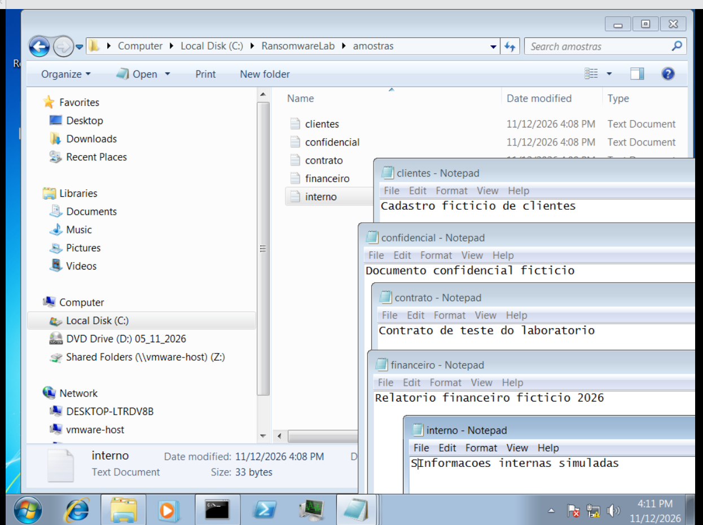

# Preparação do Laboratório, Rede Host-Only e Acesso Remoto (SMB/WMI)

**Projeto:** `dio-ransomware-lab-ai-defense`  
**Objetivo:** Configurar um ambiente virtualizado e isolado para simulação controlada de ransomware no Windows 7 Home e investigação remota assistida por IA (Hermes / PicoClaw) a partir do host Windows 11.

---

## 1. Infraestrutura e Topologia do Ambiente

| Componente | Configuração / Papel |
|---|---|
| **Host (Estação de Análise)** | Windows 11, PowerShell 5.1, Python 3.10 / 3.8, PyInstaller e Agente de IA (Hermes / PicoClaw) |
| **VM Alvo (Ambiente Vítima)** | Windows 7 Home Basic SP1 (`WIN-BTDHNBABNPN`), isolado com arquivos exclusivamente fictícios |
| **Virtualização e Rede** | VMware Workstation — Rede **Host-Only** (`VMnet1`), sem exposição da VM à internet |
| **IP do Host (`VMnet1`)** | `192.168.89.1/24` |
| **IP da VM Windows 7** | Inicialmente `192.168.89.176` / `.198` (DHCP) e fixado em `192.168.89.200/24` |
| **Conta de Investigação** | `WIN-BTDHNBABNPN\investigador` |
| **Compartilhamento de Auditoria** | `\\192.168.89.200\RansomwareLab` → `C:\RansomwareLab` (somente leitura) |


---

## 2. Preparação da Estrutura de Pastas e Amostras no Windows 7

Dentro da VM Windows 7, foi criada a árvore dedicada ao experimento em `C:\RansomwareLab`:

```text
C:\RansomwareLab\
├── amostras\             # Cinco documentos fictícios (.txt) alvo dos testes
│   ├── clientes.txt
│   ├── confidencial.txt
│   ├── contrato.txt
│   ├── financeiro.txt
│   └── interno.txt
├── backup\               # Cópias íntegras de segurança (Estado V1)
├── evidencias\           # Registros de hashes SHA-256 (originais, backup e modificados)
│   ├── hashes_originais.txt
│   ├── hashes_backup.txt
│   └── hashes_modificados.txt
├── logs_auditoria\       # Relatórios gerados localmente pelos scripts agendados
├── recuperados\          # Destino para validação de restauração
├── scripts_auditoria\    # Scripts PowerShell 2.0 executados localmente na VM
└── simulador\            # Executáveis do simulador de criptografia e chave de recuperação
```


### 2.1 Criação dos Documentos Fictícios e Backup Inicial (Estado V1)

Foram gerados cinco arquivos `.txt` contendo apenas textos fictícios de teste:

```cmd
echo Relatorio financeiro ficticio 2026 > C:\RansomwareLab\amostras\financeiro.txt
echo Cadastro ficticio de clientes > C:\RansomwareLab\amostras\clientes.txt
echo Contrato de teste do laboratorio > C:\RansomwareLab\amostras\contrato.txt
echo Informacoes internas simuladas > C:\RansomwareLab\amostras\interno.txt
echo Documento confidencial ficticio > C:\RansomwareLab\amostras\confidencial.txt
```



Em seguida, os arquivos foram copiados para `C:\RansomwareLab\backup` e seus hashes SHA-256 originais foram registrados como linha de base (**Estado V1**):

```cmd
(for %F in (C:\RansomwareLab\amostras\*.txt) do @certutil -hashfile "%F" SHA256) > C:\RansomwareLab\evidencias\hashes_originais.txt
```


### 2.2 Alterações Controladas (Estado V2) e Ponto de Restauração (Snapshot)

Para testar a capacidade da auditoria e da IA em diferenciar **modificações legítimas/incrementais** de **criptografia por ransomware**, dois arquivos receberam linhas adicionais antes da simulação:

```cmd
echo Novo cliente cadastrado em 12-11-2026 >> C:\RansomwareLab\amostras\clientes.txt
echo Receita adicional de R$ 15000 registrada >> C:\RansomwareLab\amostras\financeiro.txt
```

Um novo inventário de hashes foi gravado em `C:\RansomwareLab\evidencias\hashes_modificados.txt` (**Estado V2**) e um snapshot da VM (`Pre-Ransomware-Lab-2026`) foi registrado no VMware Workstation antes de qualquer teste de criptografia.


---

## 3. Diagnóstico de Rede, Firewall e Configuração de Acesso SMB

### 3.1 Verificação de Conectividade ICMP e Porta TCP 445

No PowerShell do Windows 11 (host), o teste de ping confirmou a comunicação pela interface Host-Only (`VMnet1`), mas a porta SMB (`445`) estava inicialmente filtrada pelo firewall do Windows 7:

```powershell
ping 192.168.89.176
Test-NetConnection 192.168.89.176 -Port 445
```


Dentro do Windows 7, foi verificado que o serviço `lanmanserver` estava ativo e escutando na porta `445`:

```cmd
sc query lanmanserver
netstat -an | findstr ":445"
```


Sem desativar o Firewall do Windows 7, foi adicionada uma regra restrita permitindo conexões TCP na porta `445` exclusivamente a partir do IP do host (`192.168.89.1`):

```cmd
netsh advfirewall firewall add rule name="Hermes SMB HostOnly" dir=in action=allow protocol=TCP localport=445 remoteip=192.168.89.1 profile=any
```


---

## 4. Superando a Filtragem UAC (`C$`) com Compartilhamento Dedicado de Leitura

Ao tentar acessar o compartilhamento administrativo padrão (`\\192.168.89.198\C$`) a partir do Windows 11, o Windows 7 retornou `Erro de sistema 5 — Acesso negado` devido à filtragem de token UAC para contas locais em conexões de rede (`LocalAccountTokenFilterPolicy`).

Para manter as boas práticas de segurança (sem desativar o UAC nem alterar o registro do sistema):

1. Foi criada a conta dedicada `investigador` no Windows 7:
   ```cmd
   net user investigador * /add
   ```
2. Foi publicado um compartilhamento SMB específico para a pasta do laboratório concedendo permissão **somente de leitura (`READ`)**:
   ```powershell
   net.exe share 'RansomwareLab=C:\RansomwareLab' '/GRANT:WIN-BTDHNBABNPN\investigador,READ'
   ```
3. No Windows 11, a sessão SMB foi autenticada apontando para o compartilhamento dedicado:
   ```powershell
   net.exe use '\\192.168.89.200\RansomwareLab' '/user:WIN-BTDHNBABNPN\investigador' '*'
   ```


Com isso, tanto o PowerShell do host quanto o agente **PicoClaw** passaram a listar e ler remotamente os arquivos e evidências da VM sem permissão de escrita ou exclusão na pasta compartilhada.


---

## 5. Configuração de WMI/DCOM e Desbloqueio de Scripts (`Unblock-File`)

Durante os testes de consulta remota via WMI (`Get-WmiObject -ComputerName 192.168.89.200`), foram ajustadas as permissões de acesso nos consoles `wmimgmt.msc` (namespace `ROOT\CIMV2`) e `dcomcnfg` (COM Security) para o usuário `investigador`.


Além disso, no Windows 11, scripts `.ps1` baixados pelo navegador recebem a marca *Mark of the Web (MOTW)*, sendo bloqueados pela política `RemoteSigned`. Para autorizar individualmente os scripts de auditoria revisados sem reduzir a segurança global do PowerShell, utilizou-se:

```powershell
Unblock-File -LiteralPath "D:\temp\scripts_lab\01_analise_arquivos.ps1"
Unblock-File -LiteralPath "D:\temp\scripts_lab\02_analise_eventos_processos.ps1"
```
